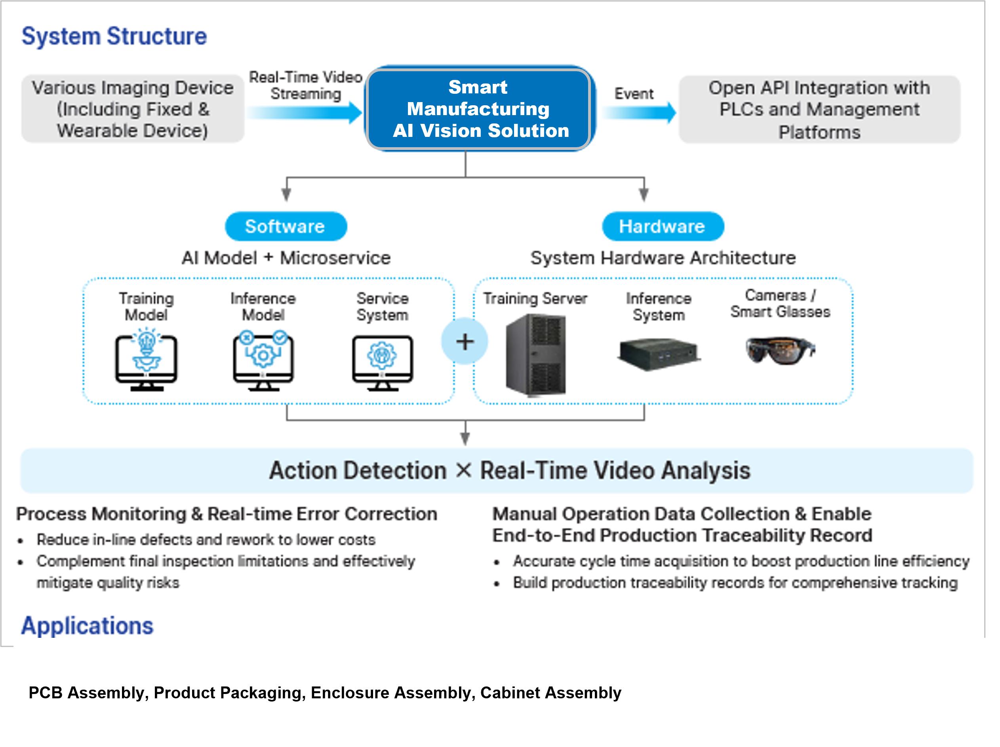

# Smart Manufacturing AI Vision Solution

### Reliable, Controllable, Traceable.

*Published by Delta Electronics*

Delta's Smart Manufacturing AI Vision Solution is an AI vision-based manual operation monitoring and error-prevention system for the manufacturing floor.

## Overview

Built around motion recognition, Smart Manufacturing AI Vision Solution brings "smart manufacturing" capability to manual operations.

The system monitors assembly actions in real time and uses AI deep learning models to determine whether each action complies with the Standard Operating Procedure (SOP), delivering instant feedback and correction the moment an error occurs.

It also automatically collects work-hour and motion data to build a traceable production record — enabling every manual workstation to achieve efficient, stable, and data-driven management: **Reliable, Controllable, Traceable.**

## System Structure

## Benefits

- **Reduce Defects and Rework:** Detect defects earlier in the production process to reduce rework rates and associated costs.
- **Minimize Quality Risks:** Complement final product inspection by identifying quality issues that may otherwise go undetected.
- **Improve Production Efficiency:** Automatically capture labor-hour and operator motion data to identify inefficiencies and optimize production processes.
- **Enable Full Process Traceability:** Record motion recognition data throughout the production process to build a complete and traceable production history.

## Advantages

- **Versatile Applications:** Supports a wide range of manufacturing processes, including both fixed and mobile workstations for a wide range of manufacturing processes.
- **Fast Deployment:** Enables rapid model development with few-shot learning (FSL), minimizing the amount of training data required.
- **Low Implementation Barrier:** No programming required. Modular configuration enables quick setup and easy adoption.
- **High Platform Integration:** Standard interfaces enable seamless integration with various management platforms and systems.
